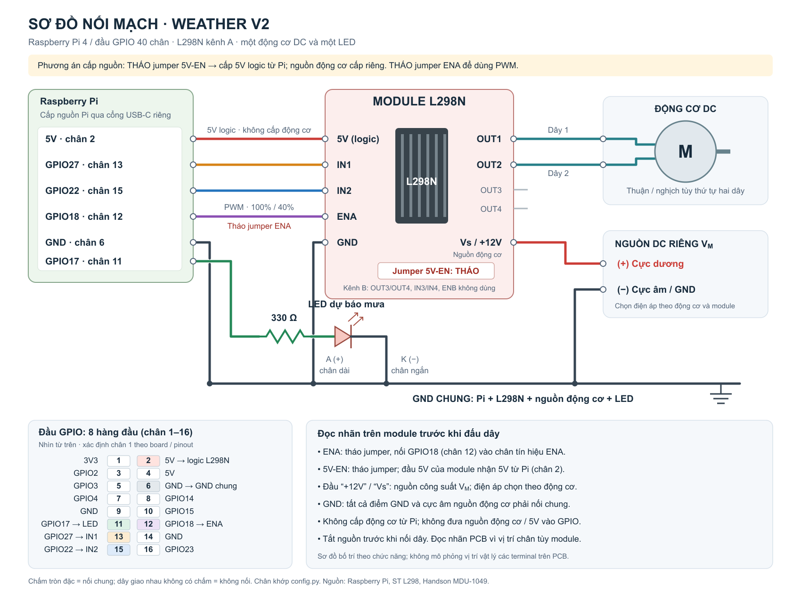

# Weather v2: theo dõi thời tiết và điều khiển động cơ DC, LED

Nhập tên thành phố, lấy nhiệt độ hiện tại, độ ẩm và xác suất mưa từ OpenWeather bằng API key của bài `weather`. Bản này dùng Raspberry Pi và mạch điều khiển động cơ **L298N, kênh A**.

| Dữ liệu nhận được | Điều khiển thiết bị |
| --- | --- |
| Nhiệt độ **t ≥ 30°C** | Động cơ DC quay thuận, nhanh: PWM **100%** |
| Nhiệt độ **t < 30°C** | Động cơ DC quay nghịch, chậm: PWM **40%** |
| Xác suất mưa **> 70%** | LED bật |
| Xác suất mưa **≤ 70%** | LED tắt |

Hai quy tắc hoạt động độc lập: nhiệt độ điều khiển động cơ, xác suất mưa điều khiển LED. Đúng **30°C** quay thuận; đúng **70%** đèn tắt. Phần trăm PWM là mức điều khiển công suất, không phải tốc độ vòng/phút đo được.

## API kế thừa từ bài cũ

`weather.py` giữ cách gọi HTTP bằng `requests`, API key qua `appid`, timeout 10 giây và thông báo lỗi của bài cũ. Các tệp nguồn trong `weather_v2` chạy độc lập sau khi cài thư viện và đặt API key.

Mỗi lần cập nhật gọi ba endpoint bằng **cùng một API key**:

1. [Geocoding API](https://openweathermap.org/api/geocoding-api): đổi thành phố thành tọa độ.
2. [Current Weather API](https://openweathermap.org/api/current): lấy `main.temp` với `units=metric` (°C) và `main.humidity` (%).
3. [5 day / 3 hour Forecast API](https://openweathermap.org/api/forecast5): lấy **một kỳ dự báo gần nhất** (`cnt=1`), đọc `list[0].pop × 100` để tính phần trăm xác suất mưa/giáng thủy.

OpenWeather định nghĩa `pop` là xác suất **giáng thủy**, có thể bao gồm tuyết tại thành phố lạnh. Trong bài này dùng `pop` làm chỉ số dự báo mưa. Mỗi kỳ dự báo có bước 3 giờ; màn hình in thời điểm kỳ dự báo theo múi giờ của thành phố. Đây là giá trị dự báo, còn nhiệt độ điều khiển động cơ lấy từ dữ liệu hiện tại. Độ ẩm và lượng mưa theo mm là các đại lượng riêng.

Nếu không tìm thấy thành phố, mất mạng, API key lỗi hoặc thiếu dữ liệu dự báo, chương trình báo lỗi, dừng động cơ và tắt LED. Chế độ theo dõi thử lấy lại dữ liệu ở chu kỳ tiếp theo.

## Nối dây trên Raspberry Pi

Xem [sơ đồ và bảng đấu dây chi tiết Raspberry Pi – L298N](WIRING.md). Sơ đồ chọn tháo jumper **5V-EN** và cấp nguồn logic L298N từ chân **5V vật lý số 2** của Pi; động cơ dùng nguồn DC riêng.



Tắt nguồn trước khi nối dây. Số GPIO trong chương trình dùng cách đánh số **BCM**. Các chân vật lý dưới đây dành cho đầu nối 40 chân của Raspberry Pi.

| Thiết bị / tín hiệu | GPIO BCM | Chân vật lý |
| --- | --- | --- |
| LED qua điện trở 220–330 Ω | GPIO17 | 11 |
| L298N IN1 (chiều thuận) | GPIO27 | 13 |
| L298N IN2 (chiều nghịch) | GPIO22 | 15 |
| L298N ENA (PWM tốc độ) | GPIO18 | 12 |
| L298N 5V logic, đã tháo 5V-EN | 5V | 2 |
| GND chung | GND | 6 |

- LED: GPIO17 → điện trở → chân dài LED; chân ngắn → GND.
- Động cơ: hai dây → OUT1 và OUT2 của L298N.
- **Tháo jumper ENA trước khi nối ENA với GPIO18** để chương trình điều chỉnh tốc độ.
- Cấp nguồn động cơ ngoài vào đầu nguồn công suất của module theo điện áp, dòng của động cơ và giới hạn module. Nối GND nguồn ngoài, GND L298N và GND Pi với nhau. Động cơ được cấp qua L298N; không nối động cơ trực tiếp vào GPIO.
- **Tháo jumper `5V-EN`**, rồi nối chân 5V vật lý số 2 của Pi vào đầu 5V logic của module. Jumper này riêng với jumper ENA. GPIO chỉ nhận tín hiệu 3,3V; không nối đầu 5V của module vào GPIO. Đối chiếu [hướng dẫn module](https://www.handsontec.com/dataspecs/L298N%20Motor%20Driver.pdf) nếu nhãn/jumper trên board khác.

L298 có hai ngõ vào chiều quay và ngõ Enable riêng; mức thấp trên Enable vô hiệu hóa cầu điều khiển. Xem [datasheet L298 của ST](https://www.st.com/resource/en/datasheet/l298.pdf) và [tài liệu gpiozero](https://gpiozero.readthedocs.io/en/stable/api_output.html#motor).

Chiều thuận phụ thuộc thứ tự hai dây động cơ. Nếu quay ngược với chiều bạn quy ước, tắt nguồn rồi đổi OUT1/OUT2. PWM 40% có thể chưa đủ để một số động cơ khởi động dưới tải; chỉnh `SLOW_SPEED` trong `config.py`, giữ thấp hơn `FAST_SPEED`. Chương trình ngắt ENA và dừng 0,2 giây trước khi đảo chiều; chỉnh `REVERSAL_PAUSE_SECONDS` theo quán tính động cơ thực tế.

## Cài đặt và chạy

Trong thư mục `weather_v2`, trên máy sẽ chạy chương trình:

```sh
python3 -m venv .venv
. .venv/bin/activate
python -m pip install -r requirements.txt
```

Nếu mang chương trình từ macOS sang Pi, chép các tệp nguồn và tạo lại `.venv` trên Pi.

Trong workspace này, `config.sh` đã được chép từ bài `weather` để dùng lại API key. Nạp key rồi chạy:

```sh
. ./config.sh
python app.py
```

Nếu cài sang thư mục mới, có thể dùng lại cấu hình bài cũ:

```sh
cp ../weather/config.sh config.sh
. ./config.sh
python app.py
```

Hoặc `cp config.example.sh config.sh`, thay `YOUR_API_KEY` bằng key OpenWeather của bạn, rồi nạp `config.sh`. Tệp chứa key đã nằm trong `.gitignore`.

Nhập `Hanoi,VN`, `Da Nang,VN`, `Ho Chi Minh City,VN` hoặc tên thành phố khác. Chương trình in dữ liệu, điều khiển thiết bị, rồi cho nhập thành phố tiếp. Thiết bị giữ trạng thái vừa cập nhật trong khi chờ nhập. Gõ `q` hoặc nhấn Ctrl+C để dừng động cơ, tắt LED và giải phóng GPIO.

Theo dõi tự động một thành phố, cập nhật mỗi 300 giây:

```sh
python app.py --watch
```

Nhập thành phố một lần. Dùng Ctrl+C để thoát; chạy lại để đổi thành phố. Có thể đổi chu kỳ, ví dụ 600 giây:

```sh
python app.py --watch --interval 600
```

Các chân GPIO, ngưỡng nhiệt độ/xác suất, tốc độ và thời gian chờ nằm trong `config.py`.

## Thử trên máy không có Raspberry Pi

```sh
. .venv/bin/activate
. ./config.sh
python app.py --mock
```

`--mock` dùng GPIO giả hỗ trợ PWM và **vẫn gọi API thật**. Có thể kết hợp `--mock --watch`. Dùng chế độ này để xem dữ liệu và trạng thái điều khiển trước khi nối phần cứng.

## Kiểm thử

```sh
.venv/bin/python -m unittest discover -s tests -v
```

Bộ 26 kiểm thử dùng HTTP giả và GPIO giả; không cần API key hay phần cứng. Đã kiểm tra các biên 30°C/70%, chiều quay và PWM, quy tắc LED độc lập với động cơ, dừng trước khi đảo chiều, lỗi API/JSON/dữ liệu, giải phóng GPIO khi thoát và cập nhật tự động sau lỗi mạng. Đã chạy toàn bộ luồng bằng API thật với key cũ và GPIO giả trên macOS. Chưa kiểm tra động cơ và LED trên Raspberry Pi thật.

## Tệp chính

- `app.py`: nhập thành phố, hiển thị, chế độ theo dõi và mô phỏng.
- `weather.py`: gọi API thời tiết hiện tại và dự báo.
- `hardware.py`: điều khiển LED, chiều quay và PWM động cơ.
- `config.py`: chân GPIO và thông số điều khiển.
- `tests/`: kiểm thử API, phần cứng giả và luồng chương trình.
